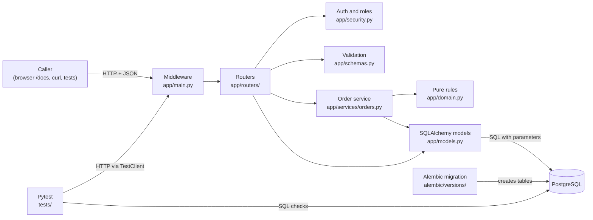
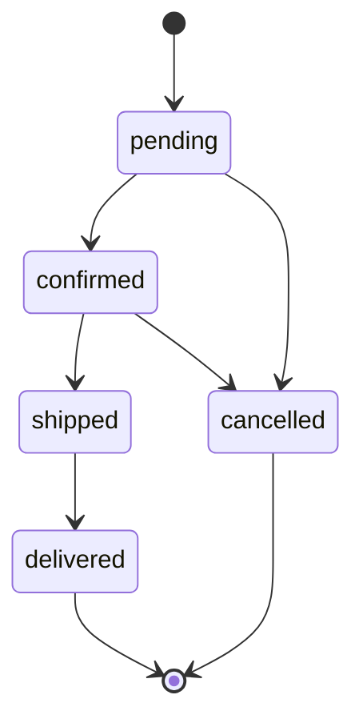
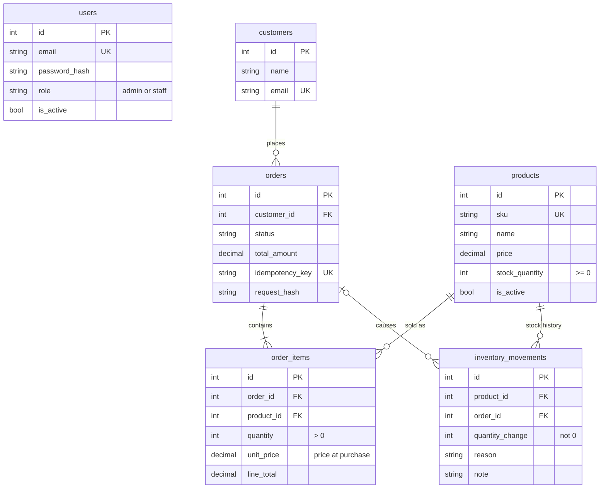

# Architecture and API reference

GitHub renders the diagrams below. Each one matches code in this repository.

## The pieces



## One order request

```mermaid
sequenceDiagram
    participant C as Caller
    participant API as FastAPI
    participant S as Order service
    participant DB as PostgreSQL
    C->>API: POST /orders (Bearer token, JSON, optional Idempotency-Key)
    API->>DB: load user from token subject
    API->>API: validate JSON (422 on bad input)
    API->>S: place_order
    S->>DB: find order with same Idempotency-Key
    alt key seen before
        S-->>C: 200 original order (or 409 if body differs)
    end
    S->>DB: SELECT products ... FOR UPDATE (ascending id)
    S->>S: check active, check stock, total = sum(price x qty)
    S->>DB: INSERT order, order_items, inventory_movements; UPDATE stock
    S->>DB: COMMIT (any failure rolls back everything)
    API-->>C: 201 order with items and total
```

## Order status rules



Cancelling puts the reserved stock back and writes an `order_cancelled` movement. Any other move returns 409.

## Tables



For every product, `stock_quantity` equals the sum of its `inventory_movements.quantity_change`. The tests check this with SQL.

## Endpoints

Every endpoint except the three health checks and login needs `Authorization: Bearer <token>`.

| Method | Path | Role | Success | Common errors |
| --- | --- | --- | --- | --- |
| GET | `/health` | none | 200 | |
| GET | `/version` | none | 200 | |
| GET | `/ready` | none | 200 | 503 database unreachable |
| POST | `/auth/login` | none | 200 token | 401, 422 |
| GET | `/auth/me` | staff, admin | 200 | 401 |
| POST | `/customers` | staff, admin | 201 | 409 duplicate email, 422 |
| GET | `/customers?limit&offset` | staff, admin | 200 page | 422 |
| GET | `/customers/{id}` | staff, admin | 200 | 404 |
| PATCH | `/customers/{id}` | staff, admin | 200 | 404, 409, 422 |
| DELETE | `/customers/{id}` | admin | 204 | 403, 404, 409 has orders |
| POST | `/products` | admin | 201 | 403, 409 duplicate SKU, 422 |
| GET | `/products?is_active&in_stock&min_price&max_price&q&sort_by&sort_order&limit&offset` | staff, admin | 200 page | 422 |
| GET | `/products/{id}` | staff, admin | 200 | 404 |
| PATCH | `/products/{id}` | admin | 200 | 403, 404, 422 |
| POST | `/products/{id}/stock-adjustments` | admin | 200 | 403, 404, 409 below zero |
| POST | `/orders` | staff, admin | 201, or 200 on replay | 409 stock or key reuse, 422 |
| GET | `/orders?status&customer_id&limit&offset` | staff, admin | 200 page | 422 |
| GET | `/orders/{id}` | staff, admin | 200 | 404 |
| PATCH | `/orders/{id}/status` | staff, admin | 200 | 404, 409 not allowed |

Every error body is `{"detail": ...}`. A request with an unknown field is rejected with 422 rather than ignored.

## Configuration

| Variable | Used by | Meaning |
| --- | --- | --- |
| `ORDERFLOW_DATABASE_URL` | API, Alembic, seed | PostgreSQL URL for the app database |
| `ORDERFLOW_JWT_SECRET` | API | Token signing key, at least 32 characters |
| `ORDERFLOW_ACCESS_TOKEN_MINUTES` | API | Token lifetime, default 30 |
| `ORDERFLOW_BCRYPT_ROUNDS` | API, seed | Password hashing cost, 4 to 16, default 12 |
| `ORDERFLOW_DB_CONNECT_TIMEOUT_SECONDS` | API | Seconds to wait for PostgreSQL, default 5 |
| `ORDERFLOW_LOG_LEVEL` | API | Default `INFO` |
| `ORDERFLOW_ADMIN_PASSWORD`, `ORDERFLOW_STAFF_PASSWORD` | seed | Passwords for the two local users |
| `ORDERFLOW_TEST_DATABASE_URL` | tests | Separate database that the tests empty before each test |
